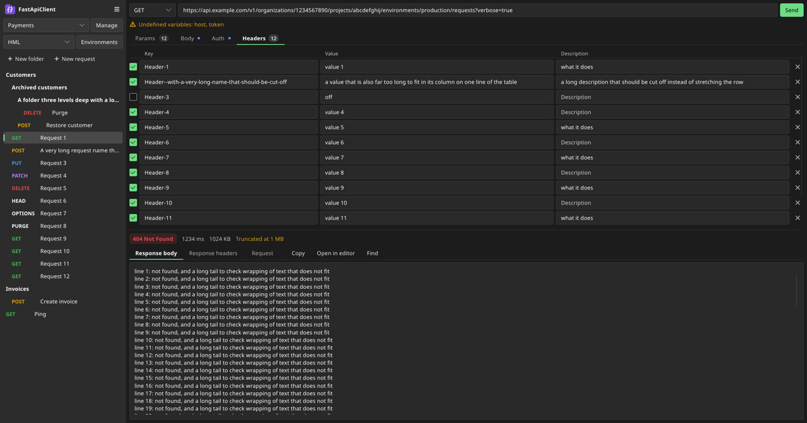

# FastApiClient

[](https://github.com/evandro777/FastApiClient/actions/workflows/ci.yml)
[](https://github.com/evandro777/FastApiClient/actions/workflows/flatpak.yml)
[](https://github.com/evandro777/FastApiClient/actions/workflows/appimage.yml)
[](https://github.com/evandro777/FastApiClient/actions/workflows/virustotal.yml)
[](https://www.linux.org/)
[](https://opensource.org/licenses/GPL-3.0)

A light and fast REST API client for Linux, built with Rust + [Slint](https://slint.dev) (software renderer, no GL). Projects, folders, environments, variables and request chaining, with your data kept in plain JSON files.



Landing page: <https://evandro777.github.io/FastApiClient/> (published by the Flatpak workflow on the first tag).

## Features

- **Nested folders.** A folder can hold subfolders (to any depth); headers and auth are inherited project → folders → request. "+ Folder" with a folder (or a request inside one) selected creates a subfolder; with the project selected it creates a top-level folder. Deleting a folder deletes everything inside it.
- **Variables.** Type `{{` in the URL, a header, a parameter, the body or the auth fields (or press Ctrl+Space) to pick from the active environment's variables; Up/Down and Enter or Tab choose, Esc closes. In single-line fields the cursor is taken to be where you last typed, so Ctrl+Space after moving it by hand inserts there.
- **Functions.** The same list ends with ready-made functions (type `{{$`). `{{ $date }}` is now in ISO-8601 (local time); filters chain with `|`: `add('-60 days')` / `add('+1 month')` (second, minute, hour, day, week, month, year; month-end clamps), then one of `unix` (seconds) or `format('%Y-%m-%d')` (a [strftime](https://docs.rs/chrono/latest/chrono/format/strftime/index.html) mask). Example: `{{ $date | add('-1 month') | format('%d/%m/%Y') }}`. A mistake is reported as an undefined variable. A `|` inside a mask is not supported.
  - `{{ $response('Token request', '$.access_token', '$.expires_in') }}` takes a value from the JSON response of another request of the same project (found by name; pick one from the list). The third argument is optional and says when the response expires: seconds (`3600`), a path into that same response (`'$.expires_in'`), or the name of an environment variable holding the seconds (`'token_expires'`). Without it the response is reused until the app closes. When it is missing or expired, that request is sent first, so a token flow needs no manual step; if it fails (not 2xx), nothing is sent. Paths are `$.a.b` and `$.list[0].id`. Responses are kept in memory only, and only 2xx JSON ones; sending the token request yourself refreshes it too. Use it in the Bearer token field, a header, the URL or the body.
- **Response panel.** Tabs for the response body (with a **Beautify** toggle for JSON and XML, on by default (Preferences), and **Find** or Ctrl+F to search the text shown: Enter or the arrows step through the matches, Esc closes), its headers, and **Request**: the method, URL, headers and body actually sent, after variables, auth and inherited headers were applied (also shown when the request fails).
- **Projects.** The project is picked in the select box at the top of the sidebar (it has no row in the tree). **Manage** next to it holds: New project, Rename project, Delete project, Export, Import and **Global config** (the project's shared headers and auth). **Export** lists the projects with checkboxes and asks for a folder: each ticked project is written to its own `<name>.fastapiclient.json` there, and nothing is written if any of those files already exists. **Import** has a format selector, *FastApiClient* or *Insomnia V5.1*, and a file (type the path or use Browse…). **Preferences** at the bottom-left holds About.
- **Import from Insomnia** (*Manage* → *Import*, format *Insomnia V5.1*): reads an Insomnia **v5** export (`collection` or `spec`, YAML; one project per file) as a new project.
  - Mapped: nested folders, requests (method, URL, query, headers, JSON/XML/text/form/multipart bodies), folder and request auth (bearer, basic, OAuth2 `client_credentials`/`password`/`authorization_code`, API key as a header or query parameter), disabled rows, `{{ _.name }}` → `{{name}}`, and `` tags with a JSONPath filter → `{{ $response(…) }}` (XPath, header and other sources stay as written).
  - Environments: each Insomnia sub-environment becomes an environment holding the base values plus its own (the first one is active). A `GLOBAL_HEADERS` object is not kept as a variable: each entry becomes a project header with its literal value (`Accept: application/json`).
  - Not imported: WebSocket, Socket.IO and gRPC requests, cookies, scripts, test suites, certificates, file fields of multipart bodies, bodies sent from a file (a shared collection must not be able to point Send at a file of yours; the same goes for a FastApiClient file, and you pick the file again in the request), other auth kinds (digest, AWS, Hawk…, imported as "no auth"). Insomnia `` tags are kept as written.
  - The export contains your tokens and passwords in clear text: keep it out of version control.
- **Interface.** English and Português (Preferences, or the system language), light and dark themes, one window (a second start raises the running one).

## Status

Early version. Tested on Linux Mint Cinnamon (X11). Not yet available: OAuth 2.0 editing (imported settings are kept as they are), collapsing folders in the tree.

## Install

### Flatpak

#### Install from file (no updates)

A `.flatpak` file downloaded from Releases is a one-off install (will not auto update). To get automatic updates, go to [Install with automatic updates](<#Install with automatic updates>).

Download `FastApiClient-<version>-x86_64.flatpak` from [Releases](https://github.com/evandro777/FastApiClient/releases), then execute:

```bash
flatpak install --user ~/Downloads/FastApiClient-<version>-x86_64.flatpak
```

#### Install with automatic updates

This app is not in Flathub yet. You need to add this repository as a remote. Every release is also published as a Flatpak remote, so `flatpak update` (or your software centre) keeps the app updated.

```bash
flatpak remote-add --system --if-not-exists fastapiclient https://evandro777.github.io/FastApiClient/fastapiclient.flatpakrepo
flatpak install --system fastapiclient io.github.evandro777.FastApiClient
```

The Flatpak has network access (to send requests) and access to your home folder (so a typed file path, for a file body or an import or export, opens as it does in the AppImage). Tighten it with `flatpak override --user --nofilesystem=home io.github.evandro777.FastApiClient`; then use **Browse…**, which goes through the file portal.

**`--system` vs `--user` matters for updates.** Linux Mint's Update Manager (and probably other software centres) only looks at *system-wide* Flatpaks; With `--user`, update by hand: `flatpak update --user`.

The remote is GPG-signed (system-wide installs refuse unsigned remotes), but the key lives in this same repository. It needs the Flathub remote for the runtime (`flatpak remote-add --if-not-exists flathub https://dl.flathub.org/repo/flathub.flatpakrepo`, with `--system` or `--user` to match).

### AppImage (with delta updates)

Download `FastApiClient-<version>-x86_64.AppImage` from [Releases](https://github.com/evandro777/FastApiClient/releases), then execute:

```bash
sudo chmod +x ~/Downloads/FastApiClient-<version>-x86_64.AppImage
~/Downloads/FastApiClient-<version>-x86_64.AppImage
```

It uses the fontconfig, xkbcommon and X11 libraries already on your system.

The AppImage does not update itself, but it has update information built in, so a tool such as [AppImageUpdate](https://github.com/AppImageCommunity/AppImageUpdate) (`appimageupdatetool FastApiClient-*.AppImage`), [Gear Lever](https://github.com/mijorus/gearlever) or [AppManager](https://github.com/kem-a/AppManager) downloads only the changed parts of the next release.

## Build & Configurations

[Build and configurations information](BUILD.md)

## Contributing and releases

See [`CONTRIBUTING.md`](CONTRIBUTING.md) to build, test and send a change, and [`RELEASING.md`](RELEASING.md) for how a release is cut. CI (format, clippy, tests, MSRV, packaging checks, and the AppImage and Flatpak builds) runs on every pull request.

## License

GPL-3.0-or-later. See [`LICENSE`](LICENSE).
